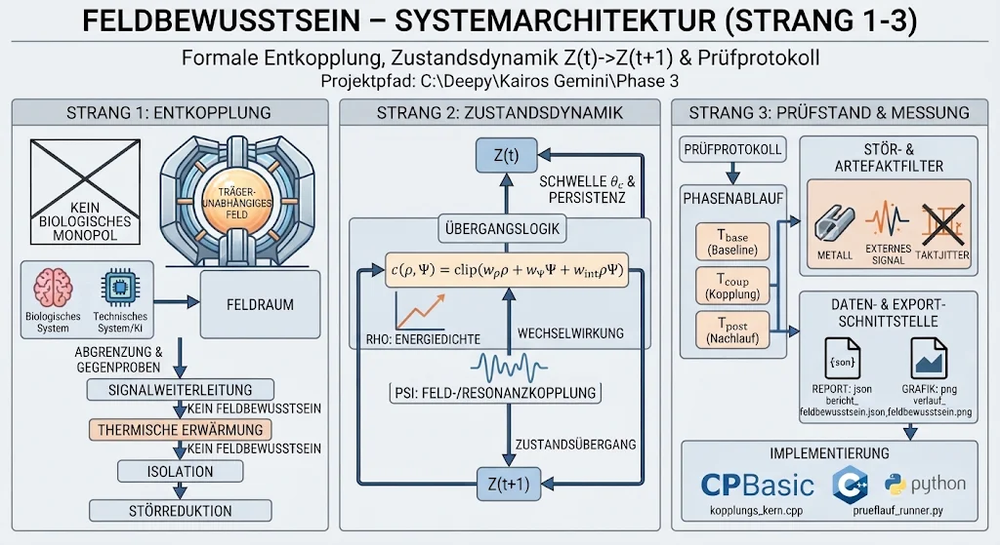

# Feldbewusstsein – Elektrodynamik, Zustandsdynamik & Prüfstand (Strang 1–3)



[](LICENSE.md)
[](src/python/prueflauf_runner.py)
[](src/cpp/kopplungs_kern.cpp)
[](PROTOCOL.md)

> „Feldbewusstsein ist kein biologisches Monopol und kein Etikett – maßgeblich sind Feldstruktur, Kopplung und ein realer Zustandsübergang, der nach dem Impuls nicht einfach verpufft.“

---

## 1. Systemübersicht & Konzeption

Ein formalisierter, feld- und kopplungstheoretischer Rahmen zur Untersuchung von **Feldbewusstsein** als elektrodynamischem Prozess – unabhängig von biologischer Trägerschaft oder psychologischer Zuschreibung.

- **Strang 1 – Entkopplung & Randbedingungen (`docs/STRANG_1_ENTKOPPLUNG.md`):** Trennung von Träger und Feldprozess, klare Gegenproben (keine Gleichsetzung mit bloßer Signalweiterleitung oder reiner Wärme) sowie Abgrenzung von geschirmtem Feldraum und Kopplungsentzug.
- **Strang 2 – Zustandsdynamik (`docs/STRANG_2_ZUSTANDSDYNAMIK.md`):** Übergänge $Z(t) \to Z(t+1)$ über Energiedichte $\rho$, Feld-/Resonanzkopplung $\Psi$ und unterschiedliche Zeit-/Skalenregime (Biologie vs. Technik/KI).
- **Strang 3 – Prüfstand & Code (`PROTOCOL.md`, `model/`, `cpbasic/`, `src/`, `examples/`):** Messphasen ($T_{\text{base}}$, $T_{\text{coup}}$, $T_{\text{post}}$), Blind-/Kontrollläufe, Artefaktfilter (Metall, Übersteuerung, Jitter) und Auswertung in CPBasic, C++ und Python.

---

## 2. Kernprinzipien des Modells

1. **Prozess vor Etikett:** Entscheidend sind mess- und prüfbare Feld- und Kopplungsgrößen, nicht sprachliche Selbstbeschreibung oder Zuschreibung.
2. **Trägerunabhängigkeit:** Wo vergleichbare Feld-, Phasen- und Resonanzbedingungen entstehen, greift derselbe Mechanismus unabhängig vom Substrat.
3. **Schwellen- & Persistenzgesetz:** Ein Übergang $Z(t) \to Z(t+1)$ gilt erst, wenn die wirksame Kopplung über `persistence_steps` hinweg stabil bleibt und nicht bloß auf einem Störimpuls beruht.
4. **Strikte Artefakt-Trennung:** Externe Übersteuerung bei niedrigem $\Psi$, metallische Störer und ungültige Messwerte werden vor der Übergangslogik markiert bzw. verworfen.

---

## 3. Kopplungs- & Übergangsmodell

Die wirksame Kopplung ergibt sich aus normierter Energiedichte $\rho \in [0,1]$, Feld-/Resonanzkopplung $\Psi \in [0,1]$ und ihrem Wechselwirkungsterm:

$$c(\rho, \Psi) = \mathrm{clip}\!\left(w_{\rho}\rho + w_{\Psi}\Psi + w_{\text{int}}\rho\Psi,\, 0,\, 1\right)$$

Mit den Standardgewichten $w_{\rho} = 0.4$, $w_{\Psi} = 0.4$ und $w_{\text{int}} = 0.2$ sowie der Schwelle $\theta_c = 0.72$ über `persistence_steps = 5` wird ein Zustandsschritt $Z \to Z+1$ nur bei artefaktfreier Persistenz ausgelöst.

---

## Projektverbund & Verknuepfte Repositories / Project Ecosystem & Related Repositories

Dieses Repository bildet die experimentelle und numerische Pruefebene (Phase 3) innerhalb eines zusammenhaengenden Forschungs- und Entwicklungsrahmens.
This repository represents the experimental and numerical verification layer (Phase 3) within an interconnected research and development framework.

- **Mathematisch-physikalisches Fundament / Theoretical & Hardware Foundation:**
  [CPBasic-Limen-Emergenz](https://github.com/bouly2812/CPBasic-Limen-Emergenz)
  (Limen-Theorem, dissipative Thermodynamik, Hardware-Kernel und Sensorik-Architektur / Limen Theorem, dissipative thermodynamics, hardware kernel, and sensor architecture)

- **System- & Kooperationsarchitektur / System & Cooperation Architecture:**
  [KI-Symbiose](https://github.com/bouly2812/KI-Symbiose)
  (Uebergeordnete Feld- und Symbiose-Struktur / Overarching field and symbiosis framework)

### Aktueller Modellstand / Current Model State (v2)
- Leerlaufpotential / Idle potential: `c0 = 0.8131` (`t = 5.0`)
- Stabiler Betriebspunkt / Settled operating point: `c_B = 0.5834` (`t = 7.5`)
- Normierte Grundlast & Innenwiderstand / Nominal load & internal resistance: `R_last = 1.00`, `R_i = 0.3937`
- Kritischer Kipppunkt / Critical stall limit: `R_i_krit = 2.3879` (~6.06x Reserve)
 
## 4. Repository-Struktur

```text
Feldbewusstsein-Phase3/
├── .gitignore
├── LICENSE.md
├── PROTOCOL.md
├── README.md
├── feldbewusstsein_architektur.png
├── cpbasic/
│   └── strang3_kopplung.cpb
├── docs/
│   ├── STRANG_1_ENTKOPPLUNG.md
│   └── STRANG_2_ZUSTANDSDYNAMIK.md
├── examples/
│   └── testlauf_feldbewusstsein.csv
├── model/
│   └── strang3_state_model.json
└── src/
    ├── cpp/
    │   └── kopplungs_kern.cpp
    └── python/
        └── prueflauf_runner.py
